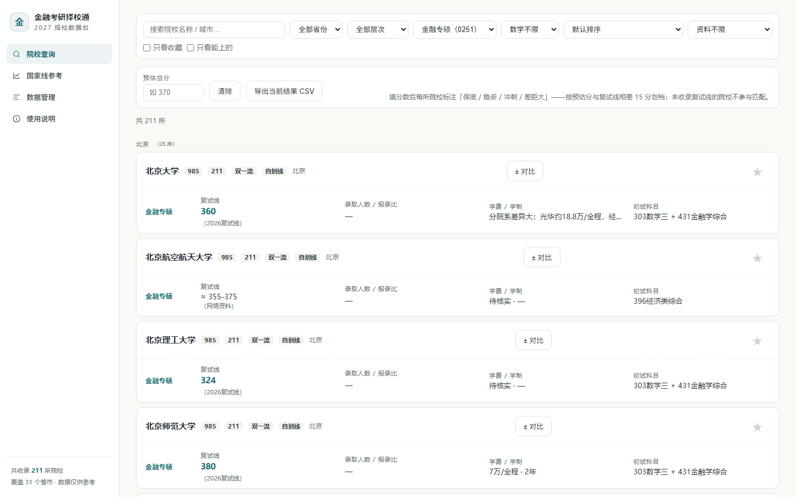
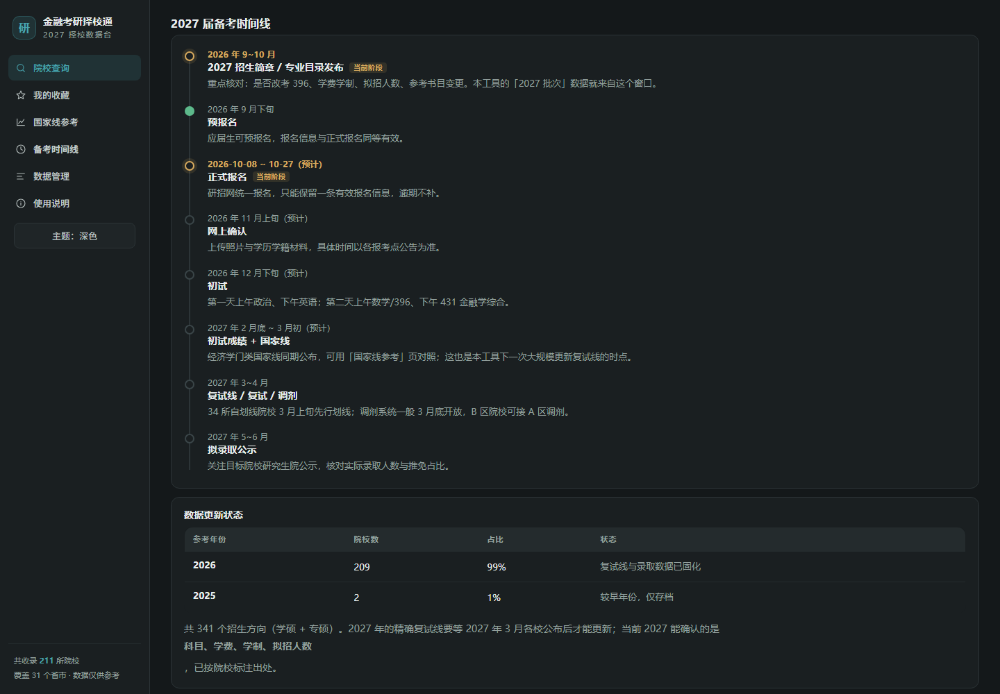
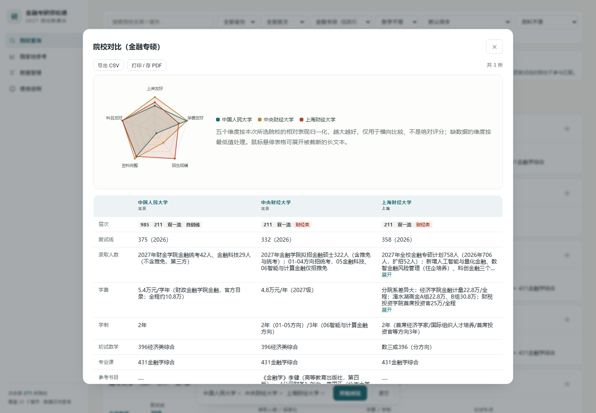
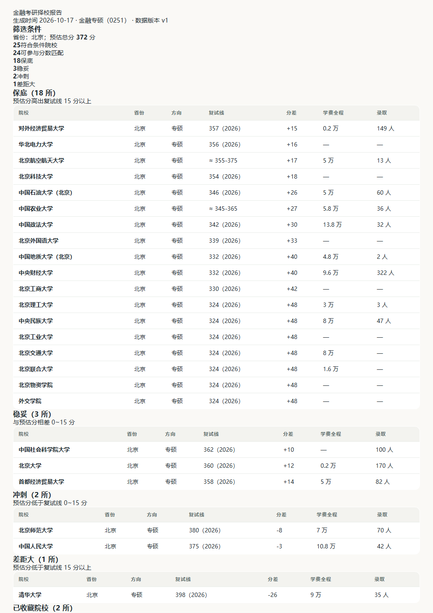

# 金融考研择校通

> 全国 31 个省市 **211 所**一本及以上院校的金融学硕（0202）与金融专硕（0251）招生数据 —— 复试线、录取人数、学费、学制、初试科目、参考书、就业口碑。可筛选、可对比、可导出，数据带出处，**查不到就留空，不编数字**。

[](./LICENSE)
[](./package.json)
[](./docs/data-gaps.md)
[](./CONTRIBUTING.md)

Electron 桌面应用 + 同一套代码的网页版（Cloudflare Pages）。数据参考年份 **2026**，2027 招生简章部分已核对（见[数据更新进度](#数据更新进度)）。



---

## 为什么做这个

金融考研择校最费时间的不是复习，是**信息收集**：每所学校的复试线、学费、报录比散落在不同官网、不同 PDF、不同年份，还常常只有图片表格。市面上的择校工具要么数据不写年份和出处，要么为了好看把空缺填成估算值 —— 你没法判断该不该信。

所以这里的取舍是：

- **每条数据标参考年份**，能点开核实来源；
- **约数和精确值分开标记**（`≈ 350-375` vs `362`），不混在一起；
- **空缺保留为空**。报名人数绝大多数院校不公布，那就是没有，不猜；
- **数据是纯 JSON**，谁都能审、能改、能提 PR —— 这是选择开源而不是做成封闭产品的核心原因。

## 功能

| 功能 | 说明 |
|---|---|
| 院校查询 | 按省份 / 层次 / 数学科目 / 资料完整度筛选，支持搜索、收藏、4 所并排对比（表格 + 五维雷达图） |
| 按分数匹配 | 填预估总分，每所院校标注「保底 / 稳妥 / 冲刺 / 差距大」（与复试线相差 15 分划档），可「只看能上的」 |
| 国家线参考 | 经济学门类 2022–2026 国家线（A/B 区总分与单科） |
| 数据管理 | 表格带搜索与「完整度」列，可增删改院校、导出/导入备份 |
| 导出 | 筛选结果导出 CSV（带 BOM，Excel 中文不乱码）；对比表导出 CSV / 打印存 PDF |
| 我的收藏 | 独立收藏页，按最新复试线排序，一键导出 CSV |
| 备考时间线 | 2027 届关键节点（简章→报名→初试→国家线→复试→录取）+ 数据年份健康度 |
| 择校报告 | 按当前筛选与预估分一键生成 A4 PDF（保底/稳妥/冲刺分组 + 数据声明） |
| 外观 | 深色模式（跟随系统，可手动三档切换）、打印样式、三档缓存策略 |
| 移动端 | ≤900px 侧栏变顶部导航、卡片降列、弹窗全屏，375px 实测零横向溢出 |
| 登录鉴权 | 网页版由 Cloudflare Pages Functions 做**服务端**校验，密码只存在服务端环境变量 |

## 快速开始

```bash
npm install        # 安装依赖
npm start          # 启动桌面应用（开发模式）
npm test           # 渲染 88 + 预览 16 + 迁移 15 + 网页版 15 + 鉴权 23 = 141 项测试
npm run dist       # 打包 Windows 安装包（输出到 dist/）
npm run verify:build  # 打包后核验三份产物与源码一致，防"漂移"
```

构建网页版（同一套渲染代码，对 Electron 的依赖只有一处 `getApi()`，无 Electron 桥时自动切浏览器模式）：

```bash
npm run build:web  # 输出 dist-web/（自包含单文件，双击即可用）
```

`dist-web/index.html` 在 `file://` 协议下实测可用；登录鉴权只在部署到 Cloudflare Pages 后生效，详见 [`DEPLOY.md`](./DEPLOY.md)。

> ⚠️ 部署坑：`wrangler pages deploy dist-web` 不会读取 `dist-web/functions/`，必须用
> `npx wrangler pages deploy . --cwd dist-web ...`，看到 `Compiled Worker successfully` 才算带上鉴权。

## 界面

稳定版界面采用 v2 视觉：暖白纸感底色、青绿主色、极淡描边分层、关键数字 800 字重收紧字距（设计参考 [aihot.news/daily](https://aihot.news/daily) 的排版语言）。

原型中的功能已全部并入稳定版（对比雷达图、收藏夹、备考时间线、择校报告 PDF、手动深浅色）。`preview/` 保留作设计试验场，不再是功能来源：




```bash
npm run preview       # 生成 preview/金融考研择校通-v2预览.html（单文件，双击可开）
npm run test:preview  # jsdom 冒烟测试 16 项
```

| 对比雷达（已并入稳定版） | 择校报告（打印存 PDF） |
|---|---|
|  |  |

> 预览页是独立单文件，**不影响** 稳定版；确认后再往 `renderer/` 合并。

## 数据说明（重要）

- 数据整理自公开资料（研招网、各校研究生院官网、当年招生简章、公开报道），**仅供参考，报考前务必以研招网（yz.chsi.com.cn）和目标院校当年招生简章为准**。
- 每条数据标有参考年份；写「约」「需核实」的字段为网络资料整理值；空缺表示公开渠道无可靠数据。
- **不编造数字**：查不到就留空，空缺本身是有效信息。
- 有官方出处的院校在详情弹窗底部列出「数据核实来源」链接。

### 数据更新进度

| 批次 | 范围 | 状态 |
|---|---|---|
| 2027 批次一 | 中央财经、上海财经、对外经贸、西南财经 —— 2027 简章学费/学制/拟招人数已核对，附官方出处 | ✅ v1.4.1 |
| 2027 批次二 | 985 全部 37 所（含北大/清华/人大/上交等），学费/学制/拟招人数/科目变更逐校核对；第三方口径均已标注 | ✅ v1.4.1 |
| 2027 批次三 | 211 / 财经类 89 所：学费/学制/拟招/科目逐校核对，64 所有可核字段，25 所官方目录为 PDF/验证码/动态系统未取得原文，留空并注明原因 | ✅ v1.5.0 |
| 2027 批次四 | 其他院校 | 待补 |

字段填充率（`npm run gaps` 生成，完整清单见 [`docs/data-gaps.md`](./docs/data-gaps.md)）：

| 精确复试线 | 数学科目 | 专业课 | 学费 | 录取人数 | 学制 | 参考书 | 报名人数 |
|---|---|---|---|---|---|---|---|
| 70% | 55% | 40% | 43% | 34% | 37% | 11% | 1% |

## 数据维护

### 应用内

「数据管理」页可添加/编辑/删除院校，保存后自动写入本机数据文件；「导出备份」生成 JSON，「导入备份」在新电脑恢复。安装版数据位于 `C:\Users\<用户名>\AppData\Roaming\finance-kaoyan-app\data.json`。

### 脚本（推荐，改动可审）

```bash
node tools/apply-batch-2027.js --dry   # 先看要改什么（幂等，可重复执行）
node tools/apply-batch-2027.js         # 写入 data/batch*.json

node tools/report-gaps.js              # 体检 + 生成 docs/data-gaps.md 分批清单
node tools/merge-research.js           # 合并 .research/ 下的调研分片
```

### 年度更新流程

1. 每年 9–10 月各校发布下一年简章后，把新数据合并进 `data/batch*.json`。
2. 在 `renderer/app.js` 顶部把 `YEARS` 加上新年份、删掉最老年份。
3. 更新 `data/national.json` 的国家线。
4. 修改 `main.js` 顶部的 `DATA_VERSION` 加 1 —— 安装版下次启动会自动迁移：
   用户没改过数据就整体替换；改过就保守合并（只补新增院校）；两种情况都会先写 `data.backup-<时间戳>.json`。
5. 改 `package.json` 的 `version`，重新打包。

### 人工校正表（`tools/data-corrections.json`）

合并时 `tags` 是取并集 —— 只会加不会减。所以「把某校错标成自划线」这类错误靠重新合并消不掉，必须在校正表里显式声明 `deleteSchools` / `removeTags` / `appendNote`，保证反复合并结果一致。

## 项目结构

```
main.js            Electron 主进程（窗口、数据读写、导入导出、数据版本迁移）
preload.js         安全桥接（contextBridge）
renderer/
  index.html       稳定版界面（四个视图 + 弹窗）
  styles.css       样式
  app.js           全部交互逻辑（筛选/详情/对比/编辑器）
data/
  national.json    历年国家线
  batch1-4.json    院校数据（华北东北 / 华东 / 中南 / 西南西北）
preview/
  _template.html   v2 界面模板（数据在构建时内联）
cloudflare/functions  网页版服务端鉴权
tools/             批次脚本、缺口报告、合并工具、测试
docs/
  data-gaps.md     数据缺口分批清单（生成物）
  screenshots/     README 截图
```

## 数据字段约定

院校对象：`id` / `name` / `prov` / `city` / `tags`（只用 985、211、双一流、财经类、自划线）/ `y` / `x`（学硕）/ `z`（专硕）/ `note` / `sources`

program（`x` / `z`）字段：

| 字段 | 含义 |
|---|---|
| `m` | 初试数学（303数学三 / 396经济类综合 / 数三或396（分方向） / 不考数学 / 待核实） |
| `j` | 专业课初试科目（如 431金融学综合） |
| `f` | 学费（`8000元/年` 或 `13万/全程` 两种口径都能解析） |
| `d` | 学制 |
| `l` | 各年复试线（对象，键为年份，**只填有公开出处的精确值**） |
| `la` | 复试线约数（无确切公开值时，如 `"360-380"`） |
| `e` / `a` | 录取人数 / 报名人数（可带说明文字，解析器取第一个非推免数字） |
| `bk` | 专业课参考书目（仅官方指定/大纲书目） |
| `emp` | 就业方向与口碑（一句话） |
| `nt` | 备注（分学院划线、推免比例、改考 396 等），用「｜」分段 |

## 参与贡献

数据纠错和补数据是最需要帮助的部分 —— 请先读 [`CONTRIBUTING.md`](./CONTRIBUTING.md)（含"一条数据的合格标准"和批次脚本写法），再用 issue 模板提交。

## 许可

代码以 [MIT](./LICENSE) 许可发布。数据整理自各院校公开信息，**版权归原发布方**；引用请注明出处，并自行核实。

## 免责声明

本项目为个人学习与择校参考工具，与任何院校、机构无隶属关系，不构成报考建议。数据可能滞后或有误，报考决策请以官方发布为准。
